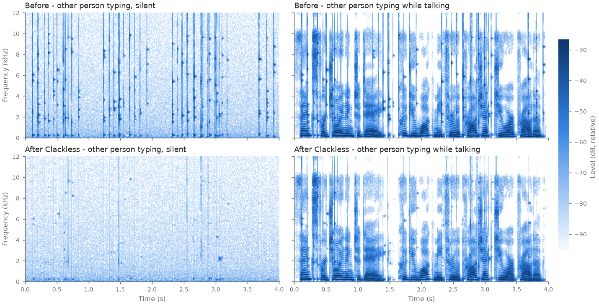

# Clackless

**Silence the other person's keyboard on your calls — and your own on theirs.**

Clackless sits between your meeting app (Teams, Zoom, Google Meet, Slack, Discord, …) and your
speakers or microphone. While the other person is quiet, a neural voice detector keeps the line
silent, so their typing simply isn't heard. When they speak, their voice passes through untouched.
It runs locally on Windows, macOS and Linux, needs no GPU, account or internet connection, and adds
about 0.1 s of delay.



*Keystroke suppression in `--no-mute` mode, on the keyboard model (top: before, bottom: after). In
the default mode the left half (typist silent) is simply silent; see
[How well it works](#how-well-it-works) for measurements on real keyboards.*

## Why

Interviews, stand-ups, 1:1s: the other side is taking notes and every keystroke lands in your
ears. Meeting apps' noise suppression targets steady noise (fans, hum) and lets many keystrokes
through. Clackless targets the keystrokes specifically.

| Mode | For | Path |
|---|---|---|
| `clackless listen` | **hearing** a call without the other person's typing | meeting app → virtual cable → Clackless → your headphones |
| `clackless mic` | **sending** your voice without your typing (+ background-noise reduction) | your mic → Clackless → virtual cable → meeting app |
| `clackless file` | cleaning a recording | `in.wav` → `out.wav` |

## Quick start

**1. Install** (Python 3.10+):

```bash
pipx install git+https://github.com/sepehrvahedi/clackless
```

or download a standalone binary from the [Releases](https://github.com/sepehrvahedi/clackless/releases)
page (no Python needed). On Debian/Ubuntu also run `sudo apt install libportaudio2`.

**2. Check that it works on your machine** (no call needed):

```bash
clackless selftest --save demo
```

It generates speech and typing, cleans them, prints measured results, and writes
`demo/typing_before.wav` and `demo/typing_after.wav` so you can listen for yourself.

**3. Install a free virtual audio cable** (one time). `clackless setup` prints the exact steps for your OS:

| OS | Cable | Notes |
|---|---|---|
| macOS | [BlackHole](https://existential.audio/blackhole/) — `brew install blackhole-2ch` | use `blackhole-16ch` as a second cable for mic mode |
| Windows | [VB-CABLE](https://vb-audio.com/Cable/) | reboot after installing |
| Linux | none needed — `clackless setup --apply` | creates PipeWire/PulseAudio virtual devices with `pactl` |

**4. Run it during a call:**

```bash
clackless listen
```

and set your meeting app's **speaker** to the cable (e.g. "BlackHole 2ch" / "CABLE Input"). Type
`b` + Enter to toggle bypass and hear the difference; `+`/`-` change the strength; `q` quits.

To stop sending **your own** typing (e.g. you are the interviewer taking notes):

```bash
clackless mic --output "BlackHole 16ch"
```

and set the meeting app's **microphone** to that cable. Mic mode also turns on gentle
background-noise reduction (`--noise 0.5`; use `--noise 0` to disable).

## How well it works

Every number below is reproduced by the test-suite (which CI runs on Windows, macOS and Linux) on
**real keyboard recordings** (a laptop, a desktop keyboard and a mechanical Keychron, see
[tests/data](tests/data/README.md)) and natural voices. Removal and voice damage are measured
separately on the same processing ("shadow filtering").

### Default: mute between speech (`clackless listen`, `clackless mic`)

| Scenario | Result |
|---|---|
| They type while you talk (they're silent) | **50+ dB(A) quieter: silent** |
| Their voice | **passes untouched** (natural voices: 25–150 dB SI-SDR, i.e. identical) |
| The start of their words | kept (≤ 0.5 dB lost in the first 200 ms) |
| Right after they stop talking | ~0.3 s of their typing can still come through before the line goes quiet |
| They type *while* talking | **not removed** (see [Roadmap](#roadmap)) |
| Their room tone between sentences | silenced too |
| Added delay | ~116 ms (an 80 ms look-ahead keeps the start of every word) |

How it works: a small neural voice-activity detector ([Silero VAD](https://github.com/snakers4/silero-vad),
bundled, MIT) decides whether someone is speaking. On real typing it fires < 0.5 % of the time; on
voices, even under loud typing, 60–85 %. The decision looks 80 ms ahead, so the line opens *before*
a word starts.

### `--no-mute`: lower delay (36 ms), keystroke suppression only

| Scenario | Real keyboards | Keyboard model (evaluation grid) |
|---|---|---|
| Typing while the typist is silent | 8–11 dB(A) quieter (about half as loud) | 23.6–26.6 dB(A) |
| Typing while the typist talks | 2–5 dB(A) | 7–13 dB(A) |
| Room tone | changed by ≤ 1.3 dB | |
| Speech with no typing | 15–40 dB SI-SDR (natural voices lowest) | ≥ 20 on the grid voices |

10 dB(A) quieter sounds roughly half as loud. Details of the method and evaluation:
[docs/HOW_IT_WORKS.md](docs/HOW_IT_WORKS.md). Product requirements:
[docs/REQUIREMENTS.md](docs/REQUIREMENTS.md).

### Measure it with *your* keyboard

The keyboard in the tests is a physical model. To check against your real keyboard:

```bash
clackless record my_typing.wav --seconds 15     # type normally, don't talk
clackless selftest --typing my_typing.wav --save demo
```

If the result looks off for your keyboard, please open an issue with the numbers (and the file
if you are happy to share it). That is the fastest way to make Clackless better.

## Commands

| Command | What it does |
|---|---|
| `clackless listen [-i IN] [-o OUT]` | clean incoming call audio (auto-detects the cable and your speakers) |
| `clackless mic [-i IN] [-o OUT]` | clean your microphone into the cable |
| `clackless file IN OUT` | clean an audio file (WAV/FLAC/OGG, any channels) |
| `clackless selftest [--save DIR] [--typing F] [--speech F]` | measure performance on this machine |
| `clackless record OUT [--seconds N]` | record your mic (to test with your own keyboard) |
| `clackless devices` | list audio devices (virtual cables are marked) |
| `clackless setup [--apply\|--remove]` | per-OS setup guide; on Linux creates/removes virtual devices |

Common options: `--no-mute` (keep the line open between speech; 36 ms delay instead of ~116 ms),
`--mute-depth DB` (how far to turn it down, default 40), `--strength 0..1` (keystroke suppression
in `--no-mute` mode), `--noise 0..1` (background-noise reduction), `--samplerate`, `--buffer-ms`.
`clackless file` takes `--mute` too. Devices can be given by index or by
part of their name.

## Privacy

Everything runs locally. Clackless makes no network connections, has no telemetry, and in live
modes writes nothing to disk.

## Limitations

* **Typing *while* they talk is not removed** in the default mode: their voice is passed through
  untouched, and so is whatever is mixed into it. `--no-mute` reduces it a little (2–5 dB(A)). A
  neural speech enhancer does better (see Roadmap).
* **~0.3 s of typing right after they stop talking** can come through before the line goes quiet.
* **Delay**: the default mode adds ~116 ms (the look-ahead that keeps word starts). In a lively
  conversation you can trade that for `--no-mute` (36 ms, typing only partly removed).
* **Silence between sentences**: with the default mode their room tone disappears between
  sentences, like many meeting apps' own noise suppression does.
* **You need a virtual audio cable** on macOS and Windows (free, one-time install). Use
  separate cables for `listen` and `mic` if you run both.
* **Linux live routing** relies on PortAudio's ALSA `pulse` device (pipewire-alsa or the
  PulseAudio ALSA plugin). It is covered by unit tests, but has had less real-world use than
  macOS and Windows so far.
* Bluetooth headsets add their own latency on top of Clackless's.

## Roadmap

* **Typing under speech**: a neural speech enhancer. [DeepFilterNet 3](https://github.com/Rikorose/DeepFilterNet)
  was evaluated on real keyboards under natural voices: it removes ~7.5 dB(A) of the typing (vs ~2 for
  the DSP), keeps clean voices nearly untouched (29–40 dB SI-SDR) and runs at 4 % of real time on a
  laptop CPU. Integrating its streaming ONNX models is the next step.
* A small GUI with a bypass button and a level meter.

## Development

```bash
git clone https://github.com/sepehrvahedi/clackless && cd clackless
python -m venv .venv && . .venv/bin/activate
pip install -e ".[dev]"
pytest                       # ~100 tests: DSP invariants, effectiveness, real-time, CLI
python scripts/evaluate.py   # the full evaluation grid; run before/after any DSP change
```

The algorithm lives in `src/clackless/dsp.py` and has no audio-device code; `realtime.py` does
the device I/O. Pull requests are welcome, especially real keyboard recordings and evaluation
results, a small GUI, and testing on more Linux setups.

Releases: push a tag `vX.Y.Z` and GitHub Actions builds and tests standalone binaries for
Windows, macOS and Linux and attaches them to the release (optional PyPI publishing is described in
`.github/workflows/release.yml`).

## License

MIT. Free to use, modify and share.
